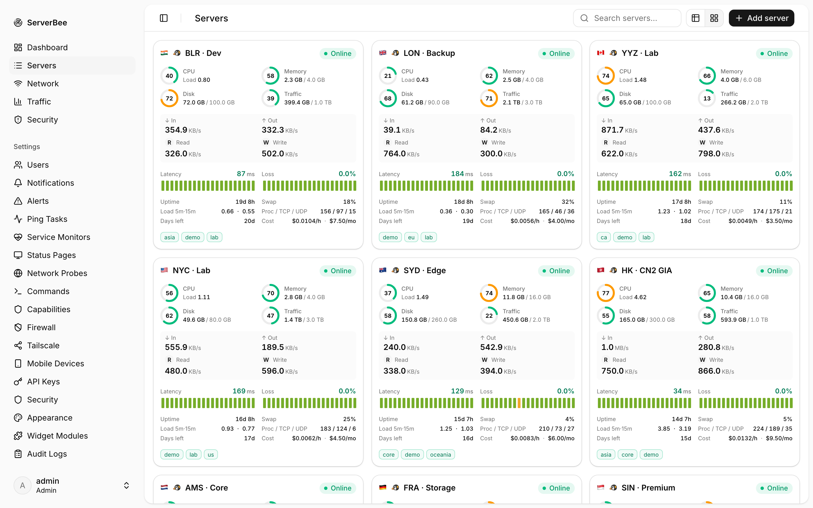

<div align="center">


# ServerBee

**Self-hosted VPS monitoring, down to every route.**

[Website](https://serverbee.app) · [Documentation](https://docs.serverbee.app/en/docs) · [Live status page](https://demo.serverbee.app/status)

[](https://github.com/ZingerLittleBee/ServerBee/actions/workflows/ci.yml)
[](https://github.com/ZingerLittleBee/ServerBee/releases)
[](LICENSE)
[](https://github.com/ZingerLittleBee/ServerBee/stargazers)

English | [简体中文](./README.zh-CN.md)

<picture>
  <source media="(prefers-color-scheme: dark)" srcset="apps/landing/src/assets/shots/fleet-en-dark.webp" />
  
</picture>

</div>

---

ServerBee tracks your whole fleet from one panel you host yourself: live load, carrier routes, IP unlock and risk, alerts, and what each server actually costs. A lightweight **agent** on each VPS reports over WebSocket to one **server** binary that carries the web UI and SQLite, so there is no external database to run.

- 🛰️ **Every route, carrier by carrier.** Up to 20 probe targets per server track latency and packet loss, with China Telecom, Unicom and Mobile compared across 31 provinces.
- 🌍 **What each IP unlocks, and how clean it is.** Every agent tests 9 streaming, AI and social services from its own egress IP every 12 hours and again the moment the IP changes. Proxy, VPN, Tor, abuser and hosting flags come with it.
- 🔒 **An agent that is not a backdoor.** Each host decides what its agent may do, and the server can read that policy but never edit it. Terminal, remote exec, file manager and Docker ship disabled; a temporary grant made on the host expires by itself.
- 💰 **What each server really costs.** Billing-day traffic cycles with a forecast, per-resource unit cost, and a flag on idle boxes you still pay for.
- 🖥️ **Your own dashboards, and a native iOS app.** Drag, resize and lock 18 widgets on a 12-column grid. The iOS app is written in SwiftUI with no third-party SDKs and no analytics.
- 🪶 **Light enough for a small VPS.** One Rust server binary with the web UI and SQLite built in. An agent uses about 4.3 MB at cold start and about 27 MB in steady state.

Also included: alerts (26 rule types, sent to Webhook, Telegram, Bark, email or APNs), public status pages, web terminal, file manager, Docker, firewall blocklist, and Tailscale or Headscale. The full list is under [Features](#features).

> [!NOTE]
> ServerBee is in beta. Expect rapid iteration.

## Quick Start

### 1. Install the server

```bash
curl -fsSL https://raw.githubusercontent.com/ZingerLittleBee/ServerBee/main/deploy/install.sh | sudo sh -s -- server --method docker
```

Open `http://your-server:9527`. The admin password is auto-generated and printed to the startup log — change it on first login.

> The install script supports both **Docker** and **native binary** installs via `--method docker|binary`. **Docker is recommended for the server**; omit the flag to choose interactively. Prefer the cloud? Use the [Railway one-click deploy](#railway-one-click) below.

### 2. Enroll an agent

Sign in as admin, choose **Add Server**, and copy the generated install command. Its Server-bound enrollment offer is single-use and expires in about 10 minutes. Then run it on that node:

```bash
curl -fsSL https://raw.githubusercontent.com/ZingerLittleBee/ServerBee/main/deploy/install.sh | sudo sh -s -- agent --method binary \
  --server-url http://YOUR_SERVER:9527 --enrollment-code YOUR_ONE_TIME_CODE
```

> A **native binary is recommended for agents** — smallest footprint and full host-level metrics. Pass `--method docker` to run the agent in a container instead.

The Agent generates and persists its run token before claiming the offer, then reconnects automatically afterwards. The code is only needed once. That's it. 🎉

## Features

| | |
|---|---|
| **📊 Monitoring** | Real-time metrics (CPU/mem/disk/network/load/temp/disk I/O, plus optional self-built NVIDIA GPU support) · historical charts (1h–30d) · Docker container stats, logs & events · monthly traffic statistics with billing-cycle prediction · cost insights (burn rate, per-resource unit cost, 0–100 value score) |
| **🔔 Alerts** | 26 rule types · threshold / offline / traffic / expiration / security-event rules · Webhook, Telegram, Bark, Email & APNs channels with notification groups |
| **🌐 Network** | Ping monitoring (ICMP/TCP/HTTP) · network-quality probing (96 China 3-ISP + international presets) · Tailscale & Headscale mesh monitoring (`Direct` vs `DERP`, MagicDNS, key expiry) · service monitors (SSL/DNS/HTTP-keyword/TCP/WHOIS) · IP-quality & streaming-unlock detection with fraud scoring |
| **🛠️ Remote management** | Browser web terminal (PTY over WS) · sandboxed file manager with Monaco editor · firewall blocklist via nftables · agent-owned capability gates with host-local temporary grants · agent auto-update |
| **🔐 Security & access** | SSH login / brute-force / port-scan detection · OAuth (GitHub/Google/OIDC) + TOTP 2FA · Tailscale Serve loopback identity auth · Admin/Member RBAC · audit logs · one-time agent enrollment codes |
| **🖥️ Dashboards & sharing** | Drag-and-drop custom dashboards (18 widget types, incl. Tailscale overview) · public status pages with 90-day uptime timelines · custom OKLCH themes · server groups with country flags · native iOS companion app |
| **⚙️ Ops** | `serverbee` management CLI · backup & restore · GeoIP region detection · OpenAPI/Swagger docs (180+ endpoints) |

## Configuration

Configure via TOML files or `SERVERBEE_`-prefixed environment variables (`__` is the nested separator, e.g. `SERVERBEE_AUTH__MAX_SERVERS`). The minimum to get going:

```toml
# /etc/serverbee/server.toml
[server]
listen = "0.0.0.0:9527"
data_dir = "/var/lib/serverbee"

[admin]
password = ""   # leave empty to auto-generate
```

```toml
# /etc/serverbee/agent.toml
server_url = "http://your-server:9527"
enrollment_code = ""   # one-time code from Add Server; only used for first claim

[collector]
interval = 3           # seconds between reports
```

📖 Full reference: **[ENV.md](ENV.md)** · OAuth, retention, rate limiting, GeoIP, and more in the [documentation](https://docs.serverbee.app/en/docs/configuration).

## Deployment

### Railway (one-click)

[](https://railway.com/deploy/serverbee-server)

Add a volume mounted at `/data` to persist data. The server auto-creates an admin account on first start — check the deploy logs for the credentials banner.

### Management CLI

The installer drops a `serverbee` CLI at `/usr/local/bin/serverbee`:

```bash
sudo serverbee status         # status of all components
sudo serverbee upgrade -y     # upgrade to latest
sudo serverbee upgrade --channel beta -y  # upgrade to the latest beta
sudo serverbee restart        # restart services
sudo serverbee config         # view / set config
sudo serverbee uninstall agent -y
```

### Reverse proxy & Tailscale sidecar

Behind Nginx/Caddy, proxy `/` to `127.0.0.1:9527` and make sure the WebSocket routes `/api/ws/` and `/api/agent/ws` forward the `Upgrade`/`Connection` headers with a long read timeout. See the [deployment docs](https://docs.serverbee.app/en/docs/deployment) for a ready-to-use Nginx config. To publish privately on a Tailnet with automatic `*.ts.net` HTTPS and optional loopback identity auth, use [`deploy/docker-compose.tailscale.yml`](deploy/docker-compose.tailscale.yml) — see the [Tailscale guide](https://docs.serverbee.app/en/docs/tailscale).

## Development

```bash
git clone https://github.com/ZingerLittleBee/ServerBee.git
cd ServerBee

make dev-full         # server (:9527) + Vite dev server (:5173) — login admin / admin123
make cargo-test       # Rust tests
make test             # frontend tests
make cargo-clippy     # Rust lint
```

> `make dev-full` runs Vite with HMR at `http://localhost:5173`, proxies `/api/*` to the Rust server at `:9527`, creates a development Server, and prints its one-time Agent enrollment command.

**Stack:** Rust (Axum 0.8 · sea-orm · SQLite WAL) · React 19 (Vite 7 · TanStack Router/Query · Bklit · shadcn/ui · Tailwind CSS v4) · Rust agents (sysinfo · tokio-tungstenite).

### Testing & quality

ServerBee ships with **3,800+ automated tests** — 3,200+ Rust (unit + 42 integration suites that drive the real Axum router over HTTP/WebSocket with a mock-agent harness) and 600+ frontend Vitest tests. Coverage is measured with `cargo-llvm-cov` (over 91% region overall; common ~98%, agent ~90%, server ~92%). CI runs zero-warning Clippy, the Rust suite, and frontend type/lint checks for the areas each change touches. See the [Testing & Quality](https://docs.serverbee.app/en/docs/testing) guide.

### Commit and PR attribution

`bun install` sets up a [Lefthook](https://lefthook.dev) `commit-msg` hook that blocks `Co-authored-by` trailers, "Generated by/with" agent text, `🤖 Generated`, `Assisted-by`, and any email address on `git commit`. The **Check commit attribution** CI job scans every commit in a pull request and the PR title and description, so `--no-verify` or `LEFTHOOK=0` will not get past it. To fix a rejected commit, run `git rebase -i <base-sha>`, drop the matching lines, and force-push. Maintainers should mark **Check commit attribution** as a required check in branch protection; the workflow cannot enable that itself.

## API

Interactive OpenAPI docs are served at `/swagger-ui` while the server runs.

## License

[AGPL-3.0](LICENSE)
