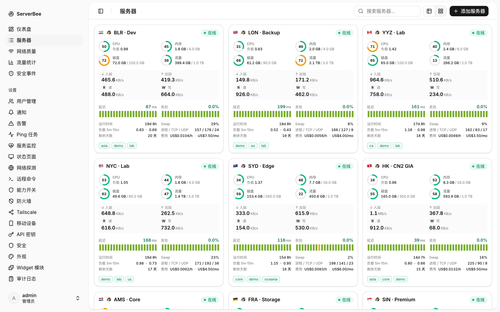

<div align="center">


# ServerBee

**自托管的 VPS 监控，细到每一条线路。**

[官网](https://serverbee.app/zh/) · [文档](https://docs.serverbee.app/zh/docs) · [状态页演示](https://demo.serverbee.app/status)

[](https://github.com/ZingerLittleBee/ServerBee/actions/workflows/ci.yml)
[](https://github.com/ZingerLittleBee/ServerBee/releases)
[](LICENSE)
[](https://github.com/ZingerLittleBee/ServerBee/stargazers)

[English](./README.md) | 简体中文

<picture>
  <source media="(prefers-color-scheme: dark)" srcset="apps/landing/src/assets/shots/fleet-zh-dark.webp" />
  
</picture>

</div>

---

ServerBee 把你手上的 VPS 收到同一个自托管面板里：实时负载、三网线路、IP 解锁、告警和每台机器的成本，打开一页就能看清。每台 VPS 上只跑一个轻量 Agent，通过 WebSocket 主动上报；服务端内置 Web 界面与 SQLite，单个可执行文件就能跑起来，不用另配数据库。

- 🛰️ **三网 31 省延迟，晚高峰见真章**。每台 VPS 可选最多 20 个探测点，持续追踪延迟和丢包。内置 31 省电信、联通、移动节点，以及 Cloudflare、Google DNS 和 AWS 东京，开箱就能按运营商拆开对比。
- 🌍 **出口 IP 干不干净，解锁自动测**。每台 Agent 每 12 小时用出口 IP 测 9 项服务，换 IP 自动复测。Netflix 区分全解锁与仅自制剧，ChatGPT 标出地区，同时附带代理、VPN、Tor、滥用与机房标记。
- 🔒 **探针不该是后门，权限归主机管**。每台主机自己决定 Agent 能开放哪些能力，服务端只读不改。终端、远程执行、文件管理和 Docker 出厂默认关闭；临时需要排障时，在主机上签一段限时授权，到点自动失效。
- 💰 **每台机器花多少钱，算得明白**。流量统计按每台 VPS 各自的账单日切周期，并给出用量预测。支持核算各项资源的单位成本，还会把闲置却仍在扣费的机器直接标出来。
- 🖥️ **自定义仪表盘，配原生 iOS App**。19 种组件（17 种核心 + 2 个内置模块）在 12 列网格里拖拽、缩放、锁定，看板按需建几张都行。iOS 端用 SwiftUI 原生编写，只用 Apple 系统框架，零第三方 SDK、不埋点，随时看实时指标与告警推送。
- 🪶 **足够轻量，两条命令跑起来**。服务端是内置 Web 界面和 SQLite 的单个 Rust 二进制，可直接运行，也支持 Docker 或 Railway。每台机器的静态 musl Agent 热缓存稳态 cgroup 内存约 2.6–3.0 MiB（进程 RSS 约 11 MiB；最低 32 MiB、推荐 64 MiB）。

此外还内置 26 种规则告警（支持 Webhook、Telegram、Bark、邮件与 APNs）、隐藏真实 IP 的公开状态页、网页终端、文件管理、Docker、防火墙黑名单，以及 Tailscale 与 Headscale 观测，完整清单见下方的[功能特性](#功能特性)表。

> [!NOTE]
> ServerBee 目前处于 1.0 beta 阶段，仍在持续迭代。

## 快速开始

### 1. 安装 Server

```bash
curl -fsSL https://raw.githubusercontent.com/ZingerLittleBee/ServerBee/main/deploy/install.sh | sudo sh -s -- server --method docker
```

打开 `http://your-server:9527`。管理员密码会自动生成并打印在启动日志中 —— 首次登录后请修改。

> 安装脚本通过 `--method docker|binary` 同时支持 **Docker** 与 **二进制** 两种安装方式。**Server 推荐 Docker 安装**;省略该参数则进入交互式选择。偏好云端?使用下方的 [Railway 一键部署](#railway一键部署)。

### 2. 接入 Agent

以管理员登录，进入 **服务器（Servers）→ 添加服务器（Add Server）**，复制生成的安装命令。其中的 Server 绑定注册凭据仅可使用一次，约 10 分钟后过期。然后在每个节点上运行：

```bash
curl -fsSL https://raw.githubusercontent.com/ZingerLittleBee/ServerBee/main/deploy/install.sh | sudo sh -s -- agent --method binary \
  --server-url http://YOUR_SERVER:9527 --enrollment-code YOUR_ONE_TIME_CODE
```

> **Agent 推荐二进制安装** —— 占用最小,且能采集完整的宿主机指标。如需在容器中运行 Agent,改用 `--method docker`。

Agent 首次连接时会保存每服务器 token 并自动重连 —— code 只需用一次。搞定。🎉

## 功能特性

| | |
|---|---|
| **📊 监控** | 实时指标(CPU/内存/磁盘/网络/负载/温度/磁盘 I/O,以及可选的自行构建 NVIDIA GPU 支持)· 历史图表(1h–30d)· Docker 容器统计、日志与事件 · 按计费周期统计月度流量并预测 · 成本洞察(burn rate、资源单价、空闲/离线成本提醒) |
| **🔔 告警** | 26 种规则 · 阈值 / 离线 / 流量 / 到期 / 安全事件规则 · Webhook、Telegram、Bark、邮件、APNs 渠道,支持通知组 |
| **🌐 网络** | Ping 探测(ICMP/TCP/HTTP)· 网络质量监控(96 个中国三网 + 国际预设)· Tailscale 与 Headscale 组网观测(`Direct` 直连与 `DERP` 中继、MagicDNS、密钥过期)· 服务监控(SSL/DNS/HTTP 关键字/TCP/WHOIS)· IP 质量与流媒体解锁检测,含欺诈风险评分 |
| **🛠️ 远程管理** | 浏览器 Web 终端(WS 上的 PTY)· 沙箱化文件管理 + Monaco 编辑器 · 基于 nftables 的防火墙封禁 · Agent 自主掌管的能力门控(支持主机本地临时授权)· Agent 自动更新 |
| **🔐 安全与访问** | SSH 登录 / 暴力破解 / 端口扫描检测 · OAuth(GitHub/Google)+ TOTP 两步验证 · Tailscale Serve 回环身份认证 · Admin/Member 角色 · 审计日志 · 一次性 Agent 注册码 |
| **🖥️ 仪表盘与分享** | 拖拽式自定义仪表盘(19 种 widget:17 种核心 + 2 个内置模块,含 Tailscale 概览)· 含 90 天可用性时间线的公开状态页 · 白标品牌定制(站点标题、Logo、Favicon、页脚)· 带国旗的服务器分组 · 原生 iOS 移动端 |
| **⚙️ 运维** | `serverbee` 管理 CLI · 备份与恢复 · GeoIP 地区检测 · OpenAPI/Swagger 文档(180+ 端点) |

## 配置

通过 TOML 文件或 `SERVERBEE_` 前缀的环境变量配置(`__` 为嵌套分隔符,如 `SERVERBEE_AUTH__MAX_SERVERS`)。管理员凭据始终在首次启动时自动生成并在服务端日志中打印一次。最小可运行配置:

```toml
# /opt/serverbee/etc/server.toml
[server]
listen = "0.0.0.0:9527"
data_dir = "/opt/serverbee/data"
```

```toml
# /opt/serverbee/etc/agent.toml
server_url = "http://your-server:9527"
enrollment_code = ""   # 来自 Servers → Add Server 的一次性 code，仅用于首次注册

[collector]
interval = 3           # 上报间隔(秒)
```

📖 完整参考:**[ENV.md](ENV.md)** · OAuth、数据保留、速率限制、GeoIP 等详见[文档](https://docs.serverbee.app/zh/docs/configuration)。

## 部署

### Railway(一键部署)

[](https://railway.com/deploy/serverbee-server)

添加挂载到 `/data` 的 Volume 以持久化数据。Server 首次启动会自动创建管理员账号 —— 在部署日志中查找凭据横幅。

### 管理 CLI

安装脚本会在 `/usr/local/bin/serverbee` 放置一个 `serverbee` CLI:

```bash
sudo serverbee status         # 查看所有组件状态
sudo serverbee upgrade -y     # 升级到最新版
sudo serverbee upgrade --channel beta -y  # 升级到最新 beta
sudo serverbee restart        # 重启服务
sudo serverbee config         # 查看 / 修改配置
sudo serverbee uninstall agent -y
```

### 反向代理与 Tailscale Sidecar

在 Nginx/Caddy 之后,将 `/` 代理到 `127.0.0.1:9527`,并确保 WebSocket 路由 `/api/ws/` 和 `/api/agent/ws` 透传 `Upgrade`/`Connection` 头且设置较长读超时。完整可用的 Nginx 配置见[部署文档](https://docs.serverbee.app/zh/docs/deployment)。如需在私有 Tailnet 内通过 `*.ts.net` 自动 HTTPS 发布面板并可选开启回环免密登录,可使用 [`deploy/docker-compose.tailscale.yml`](deploy/docker-compose.tailscale.yml),详见 [Tailscale 集成文档](https://docs.serverbee.app/zh/docs/tailscale)。

## 开发

```bash
git clone https://github.com/ZingerLittleBee/ServerBee.git
cd ServerBee

make dev-full         # Server(:9527)+ Vite 开发服务器(:5173)—— 从启动日志获取首次管理员凭据
make cargo-test       # Rust 测试
make test             # 前端测试
make cargo-clippy     # Rust 代码检查
```

> `make dev-full` 启动带 HMR 的 Vite（`http://localhost:5173`），并代理 `/api/*` 到 `:9527` 的 Rust 服务端。请从服务端启动日志获取一次性首次管理员密码，登录后在 **Servers → Add Server** 生成一次性 enrollment code，即可接入开发用 Agent。

**技术栈:** Rust(Axum 0.8 · sea-orm · SQLite WAL)· React 19(Vite 7 · TanStack Router/Query · Bklit · shadcn/ui · Tailwind CSS v4)· Rust Agent(sysinfo · tokio-tungstenite)。

### 测试与质量

ServerBee 自带 **3800+ 自动化测试** —— 其中 3200+ 为 Rust（单元测试 + 47 个集成套件，通过 mock-agent 测试桩驱动真实 Axum 路由、经由 HTTP/WebSocket 演练），以及 600+ 前端 Vitest 测试。覆盖率使用 `cargo-llvm-cov` 测量（总体区域覆盖率超过 91%；common ~98%、agent ~90%、server ~92%）。CI 会按每次变更涉及的领域运行零警告 Clippy、Rust 测试套件，以及前端类型/lint 检查。详见 [测试与质量](https://docs.serverbee.app/zh/docs/testing) 指南。

## API

服务端运行时,可在 `/swagger-ui` 访问交互式 OpenAPI 文档。

## 许可证

[AGPL-3.0](LICENSE)
